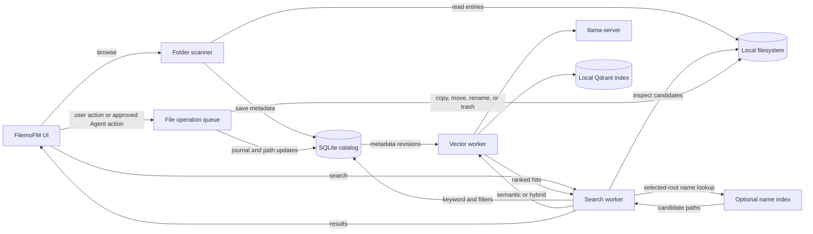

<h1 align="center">FilemoFM</h1>
<p align="center">
A portable file manager for Windows and Linux, built with Rust and egui.
</p>

> [!WARNING]
> FilemoFM is a personal project built for my own use and is still under active development. Features may be incomplete, and behavior may change.

## Contents

- [What it does](#what-it-does)
- [Browse and organize files](#browse-and-organize-files)
- [Search](#search)
- [File operations](#file-operations)
- [Optional search services](#optional-search-services)
- [Agent and MCP](#agent-and-mcp)
- [Build and run](#build-and-run)
- [Portable data](#portable-data)
- [Troubleshooting](#troubleshooting)
- [License](#license)

## What it does

FilemoFM is a desktop file manager with a local metadata catalog. It reads file metadata from folders you visit, then stores names, paths, timestamps, tags, descriptions, and references in SQLite. Keyword search works on that catalog; it does not read file contents.

The app keeps its settings, catalog, logs, optional models, native runtimes, and app trash beside the executable. No account or hosted FilemoFM service is required.

## How data moves



The SQLite catalog is the persistent source for file metadata. The vector index is a rebuildable projection. File contents are not added to the semantic index.

## Browse and organize files

- Navigate with an editable address bar, breadcrumbs, Back and Forward history, favorites, and frequently visited folders.
- Use the sidebar to reach drives, pinned locations, and system folders. The current folder can be watched for changes; the watcher is not recursive.
- Choose Details, List, Small Icons, Medium Icons, Large Icons, Extra Large Icons, Tiles, or Content. Sort and group files by name, size, dates, extension, or tags.
- Preview PNG, JPEG, WebP, and BMP images up to 50 MiB. Text previews support common text and source formats up to 1 MiB; binary or unsupported encodings are not rendered as text.
- Add colored tags and Markdown descriptions. Descriptions can link to other catalog entries, and links stay attached to the entry's stable ID if its path changes.
- See folder sizes calculated in the background. A size can be marked partial when the configured traversal limits prevent a complete measurement.
- Use dark, light, or system theme, and adjust the interface language, font size, and scale in Settings.

Scanning a folder adds or updates its immediate children in the catalog. It does not recursively index the whole disk. Folder-size measurement is a separate recursive task.

## Search

The search bar supports three modes and three scopes.

| Mode | What it searches |
| --- | --- |
| **Keyword** | Names, paths, and descriptions in the local metadata catalog. |
| **Semantic** | Similarity against the local vector index of file names, paths, tags, and descriptions. |
| **Hybrid** | Combines keyword and semantic rankings. If the vector service is unavailable, it returns keyword results and reports the fallback. |

| Scope | What it includes |
| --- | --- |
| **Current folder** | Catalog entries directly inside the current folder. |
| **Indexed files** | Catalog entries from all visited or otherwise indexed locations. |
| **Selected roots** | Catalog entries under the roots configured in Settings. Keyword search can also use the optional name index to discover matching paths under those roots. |

Text terms search file names, paths, and descriptions. Add filters to narrow the results:

| Filter | Example | Meaning |
| --- | --- | --- |
| `intitle:` | `intitle:"quarterly report"` | File name contains the phrase. |
| `type:` | `type:pdf`, `type:image`, `type:folder` | Match an extension or a category: `document`, `image`, `video`, `audio`, `archive`, or `folder`. |
| `tag:` | `tag:work` | Match a tag name, without regard to case. |
| `date:` | `date:2026-10-01..2026-10-15` | Match modification dates from October 1 through October 15, using local dates. A single date is also accepted. |

For example:

```text
intitle:"quarterly report" type:document tag:work date:2026-10-01..2026-10-15
```

Quoted text can contain spaces or colons. A Windows path such as `C:\Users` is treated as search text. Unknown filters and unclosed quotes produce a query error.

## File operations

Copy, cut, paste, move, rename, create, send to trash, restore app-trash entries, or permanently delete selected items. Paste and transfers handle name conflicts with Skip, Rename, Replace, or Merge choices. Permanent deletion asks for confirmation.

File changes run in a background queue. Before acting, FilemoFM checks that selected files have not been replaced or changed since selection. The operation journal lets startup finish or undo certain interrupted steps. Application data folders are protected from file operations.

The default trash is the operating system's trash. An app-managed trash fallback is available in Settings for locations without system-trash support. Permanent deletion bypasses trash.

Common shortcuts:

| Shortcut | Action |
| --- | --- |
| `Ctrl+C`, `Ctrl+X`, `Ctrl+V` | Copy, cut, paste |
| `F2` | Rename the selected item |
| `Delete` | Send selection to trash |
| `Shift+Delete` | Permanently delete after confirmation |
| `Ctrl+A` | Select all |
| `Alt+Left`, `Alt+Right`, `Alt+Up` | Back, forward, up one folder |
| `Ctrl+Shift+N` | Create a folder |

## Optional search services

Keyword search does not need external services. Semantic and Hybrid search need a local Qdrant runtime, `llama-server`, and a supported GGUF embedding model. These are not bundled with FilemoFM.

To set up semantic search:

1. Open **Settings → Index & vector**.
2. Register Qdrant and `llama-server` executables from sources you trust.
3. Inspect and download a supported model artifact.
4. Review the model and dimension, then build the vector index.

The default model is Qwen3-Embedding-0.6B in GGUF format. Indexing uses file names, paths, tags, and descriptions; it does not embed file contents. The app manages the local runtime processes, and the model loads when needed. Model and runtime downloads are optional.

## Agent and MCP

Agent is optional and disabled by default. It can use an Ollama or OpenAI-compatible chat endpoint. When enabled, chat messages and tool results are sent to the configured endpoint. File contents are available only when content reading is enabled and the selected tool requests a supported text file.

Access is controlled in **Settings → Agent** and **Settings → Permissions & MCP**:

- Choose the allowed filesystem roots and enable each capability separately.
- Metadata access is limited to indexed files under those roots. Content reading and semantic search have separate permissions.
- Metadata or filesystem changes proposed by Agent require approval in the app. Approval is tied to the target and its current revision, then permissions are checked again before the operation is queued.
- HTTPS is required for remote endpoints. Unauthenticated HTTP is allowed only for loopback endpoints when explicitly enabled.
- MCP runs over standard input/output with `filemofm --mcp`. It exposes read-only tools and does not start a network listener. Enable Agent, MCP stdio, metadata access, and at least one allowed root first.

The default Agent configuration has no allowed roots, no network access, and no write or content-reading permissions.

## Build and run

### Requirements

- Rust and Cargo 1.92 or newer.
- Windows x86_64 with the MSVC toolchain, or Linux x86_64 with an X11 or Wayland desktop session.
- Platform graphics and system libraries needed by the Rust dependencies.

Build and launch from the repository root:

```sh
cargo run
```

Build an optimized binary:

```sh
cargo build --release
```

The packaging helper accepts an already-built binary and a new output directory. It checks the binary format and copies the README, portable setup guide, lockfile, and a checksum manifest. It does not build the app or bundle native runtimes or models.

```sh
python3 scripts/package.py \
  --binary target/release/filemofm \
  --target x86_64-unknown-linux-gnu \
  --output /path/to/new-package
```

For runtime registration, storage, backup, restore, and packaging details, see [the portable setup guide](docs/PORTABLE.md).

## Portable data

FilemoFM uses the directory containing its executable as the application root. That directory must be writable. The app opens an exclusive lock on the metadata database, so only one instance can use the same application data at a time.

```text
<application-root>/
├── config.toml
├── data/
│   ├── filemofm.db
│   └── vectors/       # Created when the local vector service is used
├── logs/
├── models/
├── runtime/
└── trash/
```

SQLite uses write-ahead logging. Keep the data directory on a local filesystem that supports SQLite WAL, and close FilemoFM before moving the application folder. Settings → Storage can create a metadata backup and schedule a restore for the next launch. A metadata backup does not include original files, models, native runtimes, app-trash contents, or the vector database; the vector index can be rebuilt from metadata.

## Troubleshooting

- **The application cannot start or save settings:** check that the executable directory is writable and that the display session and graphics libraries are available.
- **The database is already in use:** close the other FilemoFM instance using the same application folder.
- **A preview is unavailable:** check the file type, size limit, and text encoding.
- **Semantic search is unavailable:** register both native runtimes, download a supported model, and build the vector index in Settings.
- **Agent denies a tool call:** check the allowed roots and the specific capability. Remote chat also needs network permission and a valid endpoint credential.

## License

FilemoFM is available under the [MIT License](LICENSE).
